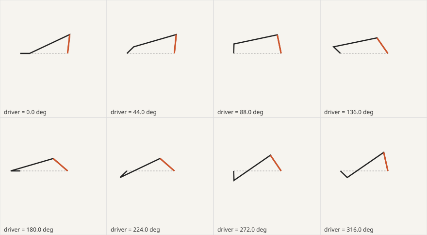
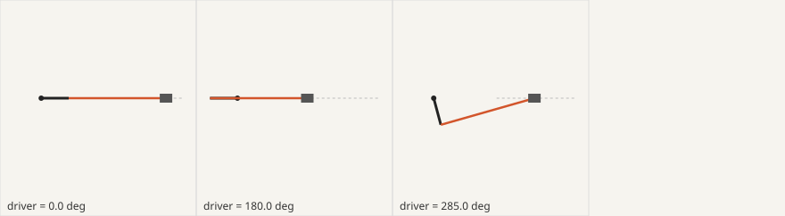

# mechanism-sheet

**English** | [简体中文](README.zh-CN.md)

**Check how a machine really moves before you draw, animate or explain it.**

`mechanism-sheet` is an agent skill for Claude Code, Codex, Cursor and any agent that reads `SKILL.md`. When someone asks "how does this work, show me", the agent first writes a *mechanism sheet*: one driver, a chain of standard elements, real dimensions graded by where they came from, and everything else computed. A zero-dependency Python checker solves the sheet over the whole cycle, flags anything that cannot physically happen, and hands the renderer a pose table and a list of numbers the labels are allowed to quote.



## The problem

Ask an agent for a machine explainer and you usually get one of these:

- **An invented machine.** Plausible shapes, generic motion, no real dimensions behind it.
- **Parts that move on their own.** The rod passes through the crank; the wiper sweeps 90° on a linkage that can only do 60°; a gear turns the wrong way.
- **Numbers typed by hand.** The caption says 15 m/s while the motion shows 11; the stated travel does not match the pinion.

The fix is not a better renderer. It is a checked model that every frame and every label reads from.

## Features

- **One driver, five standard elements.** Slider crank, four-bar, gear pair, rack and pinion, belt. Chain them (`"input": "gear.out"`), phase them, run many cylinders off one crank.
- **Source grades on every part.** `measured`, `drawing`, `datasheet`, `derived`, `estimated`, `guess`. Estimated and guessed numbers raise a warning so they never become confident captions.
- **Assembly checks over the full cycle.** Loop closure at every step, Grashof class, transmission angle, rod ratio, gear centre distance and module, undercut, rack travel, pulley clearance and belt wrap.
- **Readouts to freeze.** Stroke, dead centres, time ratio, mean and peak slider speed, output swing, ratios, belt length.
- **Key poses as beats.** Dead centres, fastest moment, rocker limits, worst transmission angle: the frames worth a pause or a label.
- **Pose table for any renderer.** CSV with one row per driver step for three.js, Blender, Manim, Remotion, SVG or a spreadsheet.
- **Contact sheet in SVG.** See the motion without building anything.
- **Claim check.** Test the numbers already in a script, caption or diagram: MATCH, OFF (with %), or UNKNOWN.
- **Zero dependencies, 64 tests.** Python 3.8+ standard library only.

## Install

The skill is the folder. Put it where your agent looks for skills.

**Claude Code**

```bash
git clone https://github.com/fangdididi/mechanism-sheet ~/.claude/skills/mechanism-sheet
# or per project: .claude/skills/mechanism-sheet
```

**Codex**

```bash
git clone https://github.com/fangdididi/mechanism-sheet ~/.codex/skills/mechanism-sheet
```

**Cursor**

```bash
git clone https://github.com/fangdididi/mechanism-sheet .cursor/skills/mechanism-sheet
```

**Skills CLI (any supported agent)**

```bash
npx skills add fangdididi/mechanism-sheet
```

**Other agents:** copy the folder anywhere and point the agent at `SKILL.md` (or reference it from `AGENTS.md`).

No install step for the helper: `python3 scripts/mech.py --help`.

## Usage

Ask in plain words:

> How does a motorcycle engine's cam stay in time with the crank? Build me a simulator.

> Make an SVG diagram of a windscreen wiper linkage for a physics class.

> Here is my explainer script. Are the numbers about this landing gear right?

The agent writes the machine card, grades the dimensions, builds the sheet, runs the checker, fixes what fails with numbers, and only then builds the visual from the pose table.

### Helper commands

```bash
python3 scripts/mech.py solve  examples/single-cylinder.json --csv poses.csv   # checks + readouts + pose table
python3 scripts/mech.py claims examples/single-cylinder.json                   # test stated numbers
python3 scripts/mech.py keys   examples/wiper-linkage.json                     # key poses worth a beat
python3 scripts/mech.py sheet  examples/wiper-linkage.json --out wiper.svg     # contact sheet (add --keys for key poses)
```

Exit codes: `0` all PASS/MATCH, `1` a WARN or UNKNOWN, `2` a FAIL or OFF, `3` invalid sheet.

## Examples

**Engine caption check.**

```
$ python3 scripts/mech.py claims examples/single-cylinder.json
  MATCH   piston.stroke stated 54.8, model 54.8 - 0.0% from the model (tolerance 0.5%) (spec sheet)
  MATCH   cam_drive.ratio stated 2, model 2 - 0.0% from the model (tolerance 1.0%) (script line 4)
  OFF     piston.mean_slider_speed_per_s stated 1.5e+04, model 1.096e+04 - 36.9% from the model ...
```

The caption "15 m/s" becomes "about 11 m/s on average, nearly 18 at its fastest".

**Wiper storyboard.** A crank-rocker scaled from a photo closes everywhere with a 57° worst transmission angle, but swings 60°, not the 90° the storyboard drew. The checker also warns that the lengths are only `estimated`.

**Landing-gear rack.** 32 teeth × module 4 = 128 mm pitch circle; half a turn moves the rack 201.06 mm. The drawing's 201 mm passes.

Key poses of the engine, drawn by `sheet --keys`:



## File structure

```
mechanism-sheet/
├── SKILL.md                    # the skill (English)
├── SKILL.zh-CN.md              # the skill (Chinese)
├── README.md / README.zh-CN.md
├── scripts/mech.py             # solver, checks, claims, key poses, CSV, SVG
├── tests/test_mech.py          # 64 tests: python3 -m unittest discover -s tests
├── examples/
│   ├── single-cylinder.json    # slider crank + cam gear, with claims
│   ├── wiper-linkage.json      # four-bar from estimated lengths
│   ├── landing-gear-rack.json  # rack travel check
│   ├── wiper-sheet.svg
│   └── engine-keys.svg
└── LICENSE
```

## Scope

Checks kinematics: where parts are and how far and fast they move. It does not check strength, forces, wear, fluids or cam profiles. Parts outside the five element types can be driven from sheet outputs in your renderer and are listed as "not checked".

## License

MIT © fangdididi
