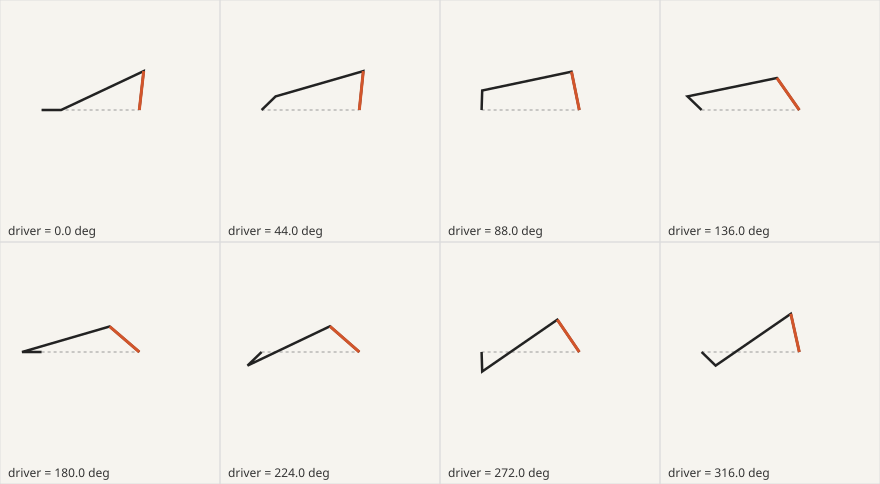
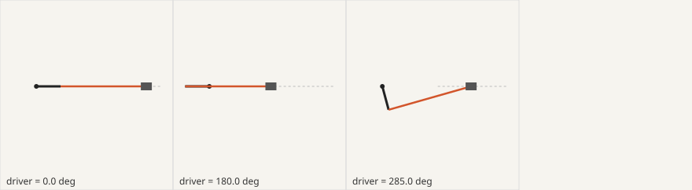

# mechanism-sheet 机构表

[English](README.md) | **简体中文**

**在绘制、动画或讲解一台机器之前，先确认它到底是怎么动的。**

`mechanism-sheet` 是一个 Agent 技能，适用于 Claude Code、Codex、Cursor 以及任何能读取 `SKILL.md` 的智能体。当有人问"这东西是怎么工作的，演示给我看"时，智能体先写一张*机构表*：一个驱动量、一串标准机构、按来源定级的真实尺寸，其余全部计算得出。零依赖的 Python 检查器在整个周期内求解，标出所有物理上不可能发生的情况，再把姿态表和"标注允许引用的数字清单"交给渲染器。



## 要解决的问题

让智能体做机器讲解，通常会得到这些：

- **想象出来的机器。** 形状像模像样，运动千篇一律，背后没有真实尺寸。
- **各动各的零件。** 连杆穿过曲柄；最多摆 60° 的连杆被画成摆 90°；齿轮转反了。
- **手打的数字。** 字幕写 15 m/s，画面里只有 11；标称行程和齿轮对不上。

解决办法不是换更好的渲染器，而是先有一个经过检查的模型，让每一帧、每一个标注都从它读取。

## 功能

- **一个驱动，五种标准机构。** 曲柄滑块、四连杆、齿轮副、齿轮齿条、皮带。可以串联（`"input": "gear.out"`）、加相位，多个气缸共用一根曲轴。
- **每个零件都有来源等级。** `measured`、`drawing`、`datasheet`、`derived`、`estimated`、`guess`。估计和猜测的数字会触发警告，不会变成自信的字幕。
- **全周期装配检查。** 每一步的回路闭合、Grashof 类型、传动角、连杆比、齿轮中心距与模数、根切、齿条行程、皮带轮间隙与包角。
- **可冻结的读数。** 行程、死点、急回比、滑块平均/峰值速度、输出摆角、传动比、带长。
- **关键姿态即节拍。** 死点、最快瞬间、摇杆极限、最差传动角——值得停顿或加标注的帧。
- **通用姿态表。** CSV，每个驱动步长一行，可用于 three.js、Blender、Manim、Remotion、SVG 或电子表格。
- **SVG 联系表。** 什么都不用搭就能看到运动。
- **数字核对。** 检验脚本、字幕、示意图里已有的数字：MATCH、OFF（附百分比）或 UNKNOWN。
- **零依赖，64 个测试。** 只用 Python 3.8+ 标准库。

## 安装

技能就是这个文件夹，放到智能体查找技能的位置即可。

**Claude Code**

```bash
git clone https://github.com/fangdididi/mechanism-sheet ~/.claude/skills/mechanism-sheet
# 或按项目放：.claude/skills/mechanism-sheet
```

**Codex**

```bash
git clone https://github.com/fangdididi/mechanism-sheet ~/.codex/skills/mechanism-sheet
```

**Cursor**

```bash
git clone https://github.com/fangdididi/mechanism-sheet .cursor/skills/mechanism-sheet
```

**Skills CLI（任意支持的智能体）**

```bash
npx skills add fangdididi/mechanism-sheet
```

**其他智能体：** 把文件夹复制到任意位置，让智能体读取 `SKILL.md`（或在 `AGENTS.md` 里引用）。

辅助脚本无需安装：`python3 scripts/mech.py --help`。

## 使用

直接用自然语言提问：

> 摩托车发动机的凸轮是怎么和曲轴保持同步的？给我做个仿真。

> 给物理课做一张雨刮连杆机构的 SVG 示意图。

> 这是我的讲解脚本，里面关于起落架的数字对吗？

智能体会写机器卡、给尺寸定级、搭机构表、运行检查器、用数字修正失败项，最后才根据姿态表制作画面。

### 辅助命令

```bash
python3 scripts/mech.py solve  examples/single-cylinder.json --csv poses.csv   # 检查 + 读数 + 姿态表
python3 scripts/mech.py claims examples/single-cylinder.json                   # 核对已有数字
python3 scripts/mech.py keys   examples/wiper-linkage.json                     # 值得做节拍的关键姿态
python3 scripts/mech.py sheet  examples/wiper-linkage.json --out wiper.svg     # 联系表（加 --keys 画关键姿态）
```

退出码：`0` 全部 PASS/MATCH，`1` 有 WARN 或 UNKNOWN，`2` 有 FAIL 或 OFF，`3` 表不合法。

## 示例

**发动机字幕核对。**

```
$ python3 scripts/mech.py claims examples/single-cylinder.json
  MATCH   piston.stroke stated 54.8, model 54.8 - 0.0% from the model (tolerance 0.5%) (spec sheet)
  MATCH   cam_drive.ratio stated 2, model 2 - 0.0% from the model (tolerance 1.0%) (script line 4)
  OFF     piston.mean_slider_speed_per_s stated 1.5e+04, model 1.096e+04 - 36.9% from the model ...
```

字幕"15 m/s"改为"平均约 11 m/s，最快接近 18 m/s"。

**雨刮分镜。** 按照片比例量出的曲柄摇杆机构全程可闭合，最差传动角 57°，但摆角是 60°，不是分镜画的 90°。检查器还会提醒这些尺寸只是 `estimated`。

**起落架齿条。** 32 齿 × 模数 4 = 128 mm 分度圆；转半圈齿条移动 201.06 mm。图纸上的 201 mm 通过。

`sheet --keys` 画出的发动机关键姿态：



## 文件结构

```
mechanism-sheet/
├── SKILL.md                    # 技能（英文）
├── SKILL.zh-CN.md              # 技能（中文）
├── README.md / README.zh-CN.md
├── scripts/mech.py             # 求解、检查、核对、关键姿态、CSV、SVG
├── tests/test_mech.py          # 64 个测试：python3 -m unittest discover -s tests
├── examples/
│   ├── single-cylinder.json    # 曲柄滑块 + 凸轮齿轮，含数字核对
│   ├── wiper-linkage.json      # 估计尺寸的四连杆
│   ├── landing-gear-rack.json  # 齿条行程检查
│   ├── wiper-sheet.svg
│   └── engine-keys.svg
└── LICENSE
```

## 范围

只检查运动学：零件在哪里、走多远、多快。不检查强度、受力、磨损、流体或凸轮廓线。五类机构之外的部分可在渲染器里由表的输出驱动，并标注为"未检查"。

## 许可证

MIT © fangdididi
